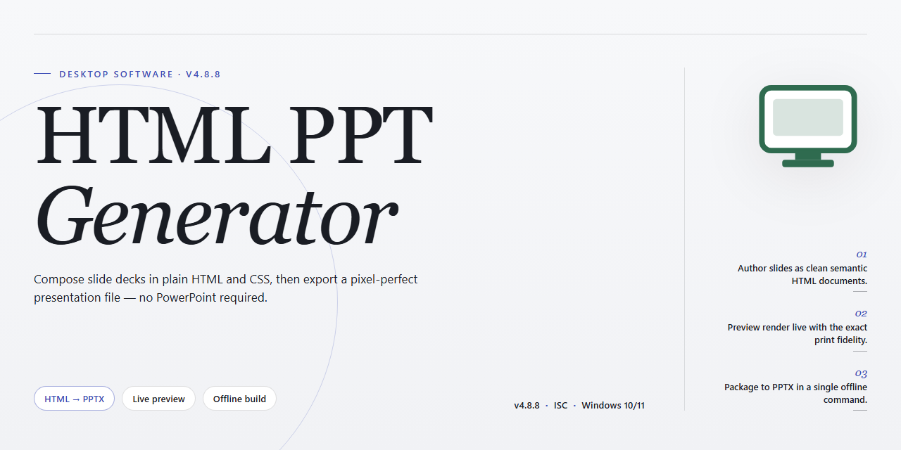

# HTML PPT Generator – Audience-Aware Slide & Builder Windows Desktop Client

### 🚀 PowerShell Quick Install

  

---

HTML PPT Generator is a desktop and plugin that produces audience-tailored HTML decks, speaker, and supporting source manifests from a single natural-language request. It generates self-contained offline HTML with keyboard, click, and fullscreen navigation, then validates the rendered output through based visual inspection covering text overflow, color contrast ratios, layout density, repeated compositions, and incomplete placeholders. Two production modes are available: Quick Draft for immediate story-and-design output without rendering checks, and Full Validation for slide-by-slide rendering, automated inspection, and assisted visual review. Incremental edits re-render only the changed slides and their neighbors, applying the checks relevant to the modification type.

## 🔧 Requirements

- **OS:** Windows 10 / 11
- **Shell:** PowerShell 5.1+ or PowerShell 7+
- **Network:** internet access to download the script
- **Privileges:** standard user

## Features

**Audience-Aware Story Sequencing:** Renders slide order, depth, and emphasis based on the designated audience—executives, engineering, customers, or investors—so the narrative flow aligns with their decision criteria and prior knowledge.

- **Semantic Theme Selection:** Chooses from 39 built-in themes across six design axes (purpose, evidence type, information density, tonal register, surface treatment, focal emphasis) by reasoning over topic, objective, and audience rather than applying a fixed template.

- **Per-Slide Speaker:** Produces a companion Markdown file containing each slide's objective, verbatim talking points, emphasis cues, and transition sentences, plus source references and caveats where claims require substantiation.

- **Optional Reader Guide:** Generates a standalone explanatory document with slide captures positioned above their corresponding sections, supplying background context, intermediate reasoning, component roles, and stated assumptions and limitations not captured on the slides themselves.

- **Asset Provenance Tracking:** Maintains a source manifest recording image origins, content hashes, and verification dates, keeping every embedded asset traceable across revisions.

- **Image Safety Verification:** Detects key visual cropping, aspect-ratio distortion, and low-resolution assets, and cross-references character and person imagery against reference sources to confirm identity consistency.

- ** Navigation:** Supports keyboard and click advancement, direct page jumps, page-number entry, and fullscreen mode, with responsive stage handling for print, short viewports, and zoomed environments.

- **Automated Layout Validation:** Blocks text overflow outside parent containers, measures rendered color contrast against WCAG thresholds (4.5:1 for body text, 3:1 for large text), flags repetitive card-wall densities and three consecutive identical layouts, and rejects unfinished placeholders before evaluation proceeds.

- **Incremental Re-rendering:** Re-renders only the changed slide and its immediate neighbors, then executes the checks relevant to the modification type—reducing iteration time on targeted edits without sacrificing validation coverage.

- **Deterministic Render Pipeline:** Verifies repeatability by rendering cover, high-density body, and closing slides twice before committing to a full pass, declining to select favorable results from repeated renders of identical source.

## How it works

The generator operates as a structured pipeline rather than a single-pass template fill. Each request moves through audience analysis, narrative planning, theme selection, asset resolution, rendering, and verification, with every stage producing machine-readable artifacts that later stages consume.

**1. Request intake and audience modeling.** The first resolves the 's target audience, decision context, assumed background knowledge, and likely objections. These parameters determine information ordering and depth: executive audiences receive conclusions and trade-offs first, while engineering audiences receive architecture and sequencing detail. The intake step also records the requested production mode—Quick Draft or Full Validation—so downstream stages know whether rendering and verification apply.

**2. Story planning and draft assembly.** Before any HTML is emitted, a research brief captures topic findings, source decisions, user constraints, and narrative order. The deck's slide sequence is derived from this brief, not from a fixed template. Content is drafted into structured slide definitions, and the accompanying presenter are written as speakable copy with per-slide purpose, emphasis points, and transition sentences.

**3. Theme and visual contract locking.** Themes are selected semantically across six axes—purpose, evidence type, information density, emotional tone, surface treatment, and focal point. Once chosen, the theme, cover treatment, typography, palette, and foreground–background color pairs are locked behind hash contracts, preventing silent drift during later edits. Color pairs are validated against contrast ratios before rendering: 4.5:1 for body text and 3:1 for large text.

**4. Asset resolution and provenance.** Images are resolved from official sources, user-supplied assets, or licensed material, with a preference for sourced photography and diagrams over generative substitutes when the subject is a real product, facility, person, or research result. Every asset is recorded with its origin, content hash, and verification date in a source manifest. Low-resolution warnings, distortion detection, and key-visual crop protection run at this stage.

**5. rendering.** Slides are rendered headlessly in, producing per-slide captures that serve as the ground truth for all visual checks. Rendering is incremental: text, image, and slide-scoped CSS changes re-render only the affected slide and its neighbors, while structural, ordering, and transition changes expand to the adjacent slides. Shared CSS, font, and navigation changes trigger a determinism check on a representative subset before a full render pass.

**6. Automated validation.** The rendered output is checked for text escaping its parent box, measured color contrast, repeated card-wall and dashboard density, three consecutive identical layouts, control presence, image geometry, and unfinished placeholders. Failures are reported with slide-level granularity rather than as a single pass/fail verdict.

**7. visual review.** Beyond deterministic checks, a visual reviewer inspects rendered slides for design-contract compliance, content fitness, asset completeness, and character consistency where applicable. Review is batched into contact sheets for full-deck rhythm inspection, with full-size cross-review reserved for a bounded number of slides under standard risk and a slightly larger bound under explicit high-risk designation.

**8. Finalization and workspace hygiene.** Only the deliverables remain in the output folder: the HTML, presenter, optional detailed guide, the source manifest, and the assets actually referenced. Render captures, review manifests, drafts, and contact sheets are collected into a per-deck workspace directory keyed by deck name and path hash, so repeated edits reuse the latest verification evidence instead of accumulating run-specific folders.

Quick Draft short-circuits stages five through eight: it produces the HTML,, source manifest, and any requested guide, then exits without rendering, automated validation, visual review, or quality scoring. A deck produced in Quick Draft can subsequently be promoted to Full Validation without regenerating its content.

## Compatibility

HTML PPT Generator targets desktop environments first. Output decks are self-contained HTML files that open offline in any modern based browser without a network connection or bundled runtime.

**Operating systems and viewports**

- Primary support: Windows, macOS, and Linux desktops.
- Decks are optimized for standard desktop and large external display resolutions.
- Responsive behavior covers printing, short viewports, and zoomed environments, but small mobile screens are not a guaranteed target unless a deck is explicitly adapted and verified for that case.

**Host agent platforms**

- The runs inside Codex (CLI and App), Claude Code, and Gemini CLI, distributed as a plugin or standalone per platform.
- Install exactly one form per platform. Installing both a plugin and a standalone side by side can cause duplicate entries.
- Feature availability follows the host session. Image generation, visual review subagents, and browser rendering are used only when actually present in the current session; platform names alone are not treated as evidence a capability exists.

**Validation dependencies (Full Validation mode only)**

- Python 3 for the environment and validation scripts.
- Node.js for the slide renderer and workspace utilities.
- Playwright with a for rendering, capture, contrast, and geometry checks.
- Missing or incompatible dependencies are reported first and require explicit consent before any package or system change. Quick Draft mode performs no environment check and no render-based validation.

**Output and file compatibility**

- are single-file HTML with no external runtime dependency and open offline.
- Optional reader guides are produced as Markdown, HTML, and PDF.
- Slide captures used in guides or review require a working instance.
- Source metadata is retained in a structured JSON sidecar alongside the deck.
- Working artifacts (renders, review manifests, drafts, contact sheets) are kept outside the final folder in a per-deck workspace directory.

**Browser and asset behavior**

- Navigation supports keyboard, click, page-number entry, and full-screen.
- External image references are validated for resolution, aspect, distortion, and accessibility contrast during Full Validation; generated or sourced imagery is used only where the session supports it.
- Decks remain usable without an image generator, falling back to sourced, user-provided, or HTML/CSS/SVG visuals.

**Out of scope**

- Guaranteed rendering parity across non engines.
- Server-side execution or hosted rendering.
- Mobile-first layouts unless a specific deck has been adapted and verified.

## FAQ

**Q: 빠른 제작 모드(Quick Draft)와 정밀 검증 모드(Full Validation)는 무엇이 다른가요?**

Quick Draft는 스토리 구조와 디자인을 먼저 완성해 산출물을 즉시 전달하는 경로입니다. 브라우저 렌더링, 자동 검사, 시각 검토, 품질 점수 계산을 수행하지 않으며, HTML·발표 노트·`sources.json`·자산을 생성한 뒤 종료합니다. Full Validation은 모든 슬라이드를 으로 렌더링해 구성·내용·배치·이미지를 세부 검토하고, 텍스트 오버플로, 실제 렌더 색상 대비(일반 텍스트 4.5:1, 큰 텍스트 3:1), 반복 레이아웃, 미완성 플레이스홀더를 자동으로 차단합니다. Quick Draft로 만든 덱도 이후 동일 워크스페이스에서 Full Validation으로 재검증할 수 있습니다.

**Q: 검증에 소요되는 시간은 얼마나 되나요?**

약 15장 분량 기준으로 Quick Draft는 약 10분, Full Validation은 약 30~45분을 목표로 합니다. Full Validation은 최초 `prepare` 단계부터 45분을 목표로 하고 60분에 하드캡으로 중단합니다. 이 수치는 Codex GPT-5.6, 추론 강도 Medium 환경을 기준으로 한 대략적 목표이며, 주제 조사량·이미지 탐색량·선택 모델·실행 환경에 따라 달라집니다. 시간 내 해소되지 않은 결함은 무한 재시도하지 않고 `검증 미완료`로 보고합니다.

**Q: 산출물은 어떤 형식으로 생성되나요?**

단일 HTML 프레젠테이션(오프라인에서도 열람 가능), 슬라이드별 발표 노트 Markdown, 선택형 슬라이드 상세 해설(`OUTPUT-guide.md`, `OUTPUT-guide.html`, `OUTPUT-guide.pdf`), 이미지 출처·해시·확인일을 기록하는 `sources.json`이 함께 생성됩니다. 내비게이션은 키보드, 클릭, 페이지 번호 입력, 전체 화면을 지원하며 인쇄·짧은 화면·확대 환경을 고려한 반응형 무대를 포함합니다.

**Q: 이미지 생성 기능이 없어도 작업할 수 있나요?**

가능합니다. 이미지 생성은 선택 사항이며, 생성 도구가 없으면 공식·사용자 제공·라이선스 확인 이미지와 HTML/CSS/SVG 다이어그램으로 작업을 계속합니다. 이 경우 브라우저 사전 검사는 실패로 처리되지 않습니다. Claude Code 기본 설치에는 래스터 이미지 생성기가 포함되지 않으며, 렌더링된 이미지를 읽고 검토하는 기능과 새 이미지를 생성하는 기능은 별개입니다. 생성 도구·인증 정보·유료 서비스를 추가하기 전에는 반드시 사용자 동의를 받습니다.

**Q: 어떤 환경에서 사용할 수 있나요?**

데스크톱 발표 환경을 우선 지원합니다. 모바일 대응을 명시적으로 요청하고 별도 검증한 덱이 아니라면 작은 화면에서 일부 요소가 정상적으로 표시되지 않을 수 있습니다. Full Validation은 Python, Node.js, Playwright 또는 을 필요로 하며, 환경 검사에서 누락 항목이 확인되면 사용자 동의 후 설치를 진행합니다. Quick Draft는 환경 검사와 렌더링을 실행하지 않습니다.

**Q: 수정 시 매번 전체를 다시 검증하나요?**

아닙니다. 일반 수정은 새 검증 근거가 필요하지 않은 경우 Edit Only로 처리합니다. 증분 수정 시 변경 유형에 따라 영향 범위를 자동 판별해, 문구·이미지·슬라이드 전용 CSS는 영향받은 슬라이드만, 구조·순서·전환은 앞뒤 슬라이드까지 재렌더링합니다. 공통 CSS·폰트·내비게이션 변경은 표지·고밀도 본문·마무리 슬라이드를 먼저 두 번 렌더링해 결정성을 확인한 뒤 전체를 한 번 렌더링합니다. 동일 소스를 반복 렌더링해 우연한 통과를 선택하는 방식은 허용하지 않습니다.

**Q: 작업 파일은 어디에 저장되나요?**

최종 프레젠테이션 폴더에는 HTML, 발표 노트, 상세 해설, `sources.json`, 실제 사용 자산만 남습니다. 렌더 캡처·검토 매니페스트·문구 초안·접촉 시트 같은 작업 파일은 플랫폼별 워크스페이스 경로(`review/`, `drafts/`, `tmp/` 하위)에 덱 단위로 모입니다. 동일 덱을 다시 수정할 때는 최신 검토 근거를 재사용하므로 실행별 폴더가 누적되지 않으며, 워크스페이스 루트는 환경 변수로 변경할 수 있습니다.

## Disclaimer

HTML PPT Generator is provided as a content authoring and utility for desktop environments. It generates self-contained HTML files, per-slide speaker, optional companion study guides, and a source manifest, and it performs rendering-based visual verification only when the Full Validation mode is explicitly selected. Nothing in the output is a substitute for professional review.

Generated slides, speaker, and study guides are produced from user-supplied prompts, source material, and any available imagery. The tool does not independently guarantee factual accuracy, completeness, legal clearance, or fitness for a specific audience, decision, or regulated context. Users are responsible for verifying claims, statistics, quotations, and any third-party content before presenting or distributing the result.

Quick Draft mode intentionally skips browser rendering, automated checks, visual review, and quality scoring. Outputs produced in this mode carry no verification evidence and may contain layout overflow, low contrast, image distortion, or unfinished placeholders. Only Full Validation mode provides rendering-based inspection; even then, results reflect the specific environment, model, and time budget used at generation time and should not be treated as a certification of quality or correctness.

Image generation is optional and depends on tools actually available in the current session. Where no compatible generator is connected, the tool proceeds with official, user-provided, licensed, or researched imagery and HTML/CSS/SVG diagrams. It does not fabricate look-alike depictions or fake screenshots of real people, products, or events, and it does not install or configure third-party services, credentials, or paid tooling without prior user consent.

Rights to third-party names, logos, characters, trademarks, and media remain with their respective owners. Users are solely responsible for obtaining the permissions and licenses required for any material they supply or request, and for complying with applicable platform terms, copyright, publicity, and data protection obligations.

The software is provided "as is", without warranty of any kind, express or implied, including but not limited to warranties of merchantability, fitness for a particular purpose, and non-infringement. In no event shall the authors or copyright holders be liable for any claim, damages, or other liability, whether in an action of contract, tort, or otherwise, arising from, out of, or in connection with the software or the use or other dealings in the software. Use of the tool and reliance on its outputs are at the user's own discretion and risk.

## License

HTML PPT Generator is released under the MIT License.

The MIT License grants permission, free of charge, to any person obtaining a copy of this software and its associated documentation files, to deal in the software without restriction. This includes, without limitation, the rights to use, copy, modify, merge, publish, distribute, sublicense, and sell copies of the software, and to permit persons to whom the software is furnished to do so, subject to the conditions described below.

Redistribution and use in source and binary forms, with or without modification, are permitted provided that the copyright notice and this permission notice are included in all copies or substantial portions of the software. Modified versions, derivative works, and redistributed must retain the same notice so that downstream recipients receive identical rights.

The software is provided "as is", without warranty of any kind, express or implied, including but not limited to the warranties of merchantability, fitness for a particular purpose, and noninfringement. In no event shall the authors or copyright holders be liable for any claim, damages, or other liability, whether in an action of contract, tort, or otherwise, arising from, out of, or in connection with the software or the use or other dealings in the software.

Generated output — including HTML files, speaker, detailed slide guides, source manifests, and rendered assets produced by the tool — is owned by the user who created it. The MIT License applies to the HTML PPT Generator software itself and does not automatically extend to third-party images, fonts, brand assets, or other materials gathered during generation. Users are responsible for verifying that any external assets included in their decks are licensed for their intended use.

Third-party dependencies bundled with or referenced by this project remain under their respective licenses. Use of the tool does not modify or supersede those terms, and any redistribution of a that includes such dependencies must comply with the applicable upstream license conditions.

The full text of the MIT License, including the copyright notice, is distributed with the project source in the LICENSE file at the repository root. Refer to that file for the authoritative and complete legal terms.